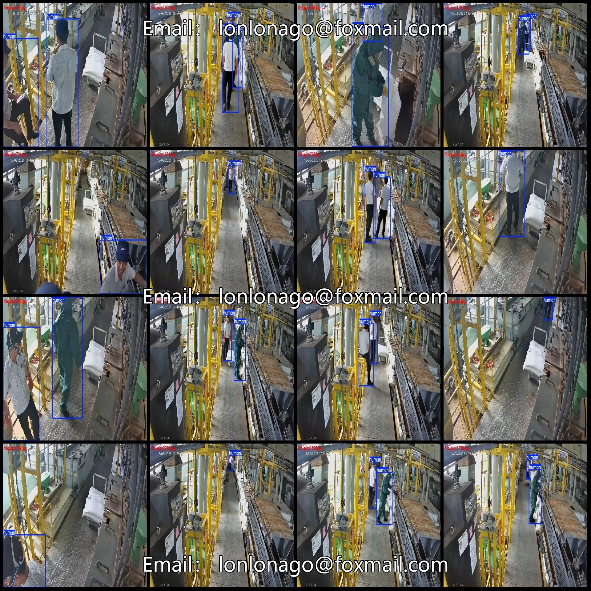
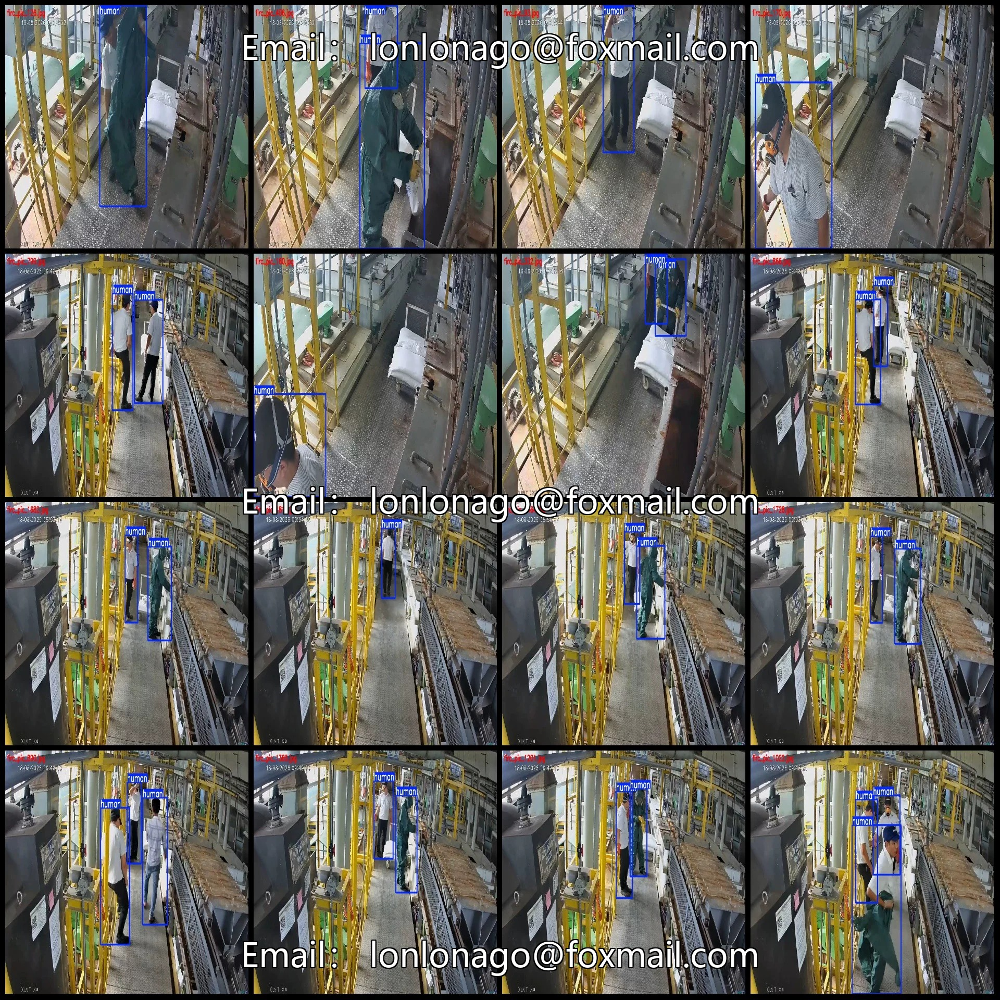
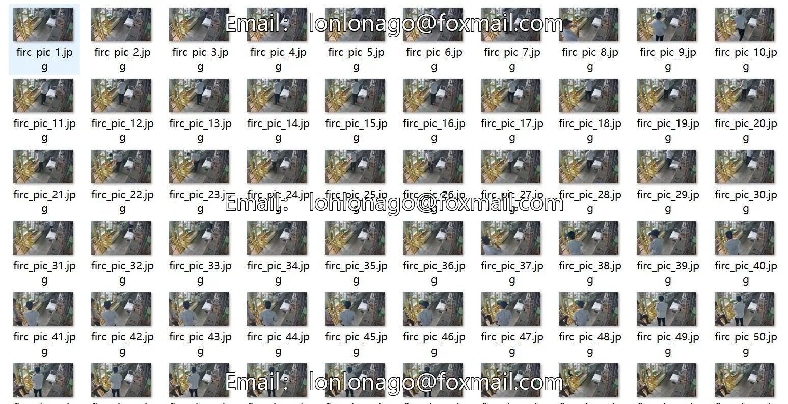
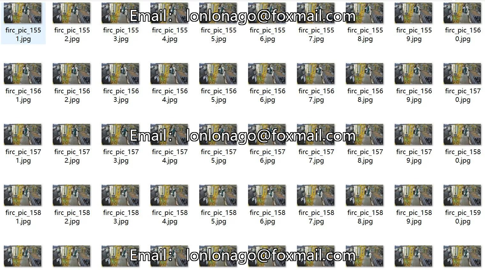

# Industrial workshop worker detection dataset VOC+YOLO format 2131 categories

## Body

Industrial workshop worker detection dataset VOC+YOLO format: 2131 images in one category
Tips: Due to the dataset's replicability, please confirm compliance before purchasing.
Note: The dataset images are formed by video frames specifically refer to the image description.
Dataset format: Pascal VOC format + YOLO format (txt file without split path, only containing jpg images and corresponding VOC format xml files and yolo format txt files)
Number of images (number of jpg files): 2131
Number of annotations (number of xml files): 2131
Number of annotations (number of txt files): 2131
Number of annotation categories: 1
Annotation category name: ["human"]

Number of boxes and image counts per category
Human boxes = 4164, image counts = 2131
Total number of boxes: 4164
Image resolution: 1280x720
Labeling tool used: labelImg
Labeling rules: Draw a rectangle around the category.
Important note: The dataset does not have separate training, validation, or test sets; you need to partition them yourself.
Special declaration: This dataset does not guarantee the accuracy of the trained models or weight files.

## Images

## Payment

Here is a pay link on Stripe ( https://buy.stripe.com/3cs8yP7sY87d0vu9AB ). Please contact me lonlonago@foxmail.com after funding $89, and I will send you a complete data files , thank you!

